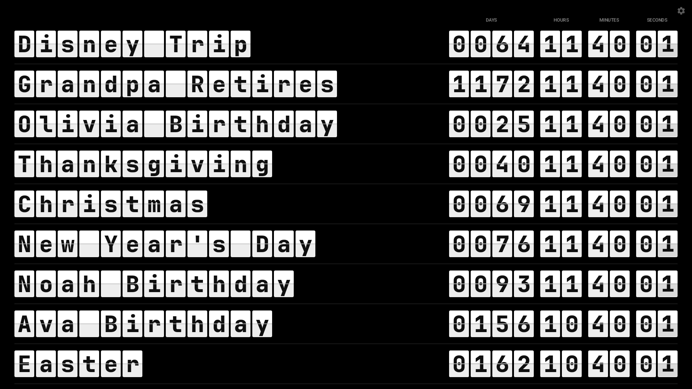
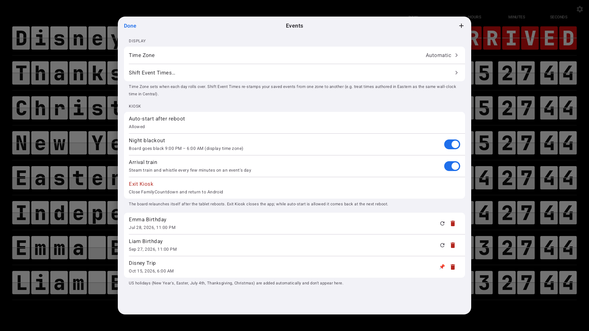
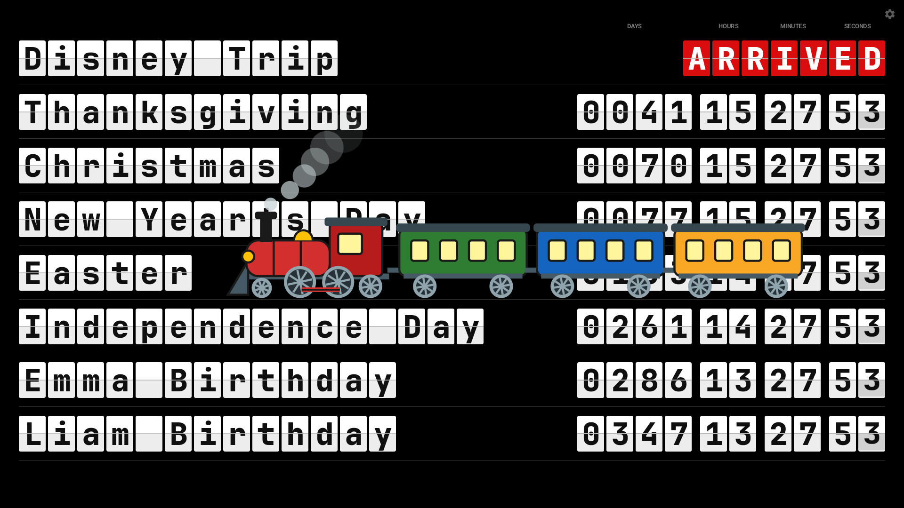

# FamilyCountdown (Android kiosk)

A native Android port of the
[FamilyCountdown iPad app](https://github.com/cbDialogs/FamilyCountdown_iOS):
a black "train-station board" listing events by name with a split-flap countdown
of days / hours / minutes / seconds until each one. On the event's day the digits
are replaced by a red **ARRIVED**; the day after, repeating events (birthdays)
roll to next year and one-time events drop off. US holidays (New Year's, Easter,
July 4th, Thanksgiving, Christmas) are added automatically. The list is edited
and stored on-device — no server or password.



Built for a 15.6" 1920×1080 Android 12 touch kiosk (HIGOLE all-in-one) running
in landscape, but it works on any landscape tablet from Android 8 (API 26) up.

The gear (top-right), or a tap anywhere on the board, opens the editor: set
the display time zone, shift saved event times between zones, add / edit /
delete events, grant the one permission needed for auto-start after a reboot,
switch the night blackout, the arrival train and the flap sounds on or off, and
**Exit Kiosk** (close the app and return to Android).



Tap the first tile of the top row for a little **razzle dazzle**: every tile on
the board flips through random letters and digits for about five seconds in a
left-to-right wave, to the sound of a deck of cards being shuffled, then settles
back on the real display.


**Night blackout** (on by default) paints the board black from 9:00 PM to
6:00 AM in the display time zone. A tap on the black screen still opens the
editor, where the switch lives.

**Arrival train** (on by default): on an event's day, while its row shows
ARRIVED, a cartoon steam locomotive pulling three passenger cars crosses the
middle of the board from right to left with a steam whistle, about ten seconds
after the arrival first shows and then at a random interval of two to five
minutes for the rest of the day (never during night blackout). The whistle
plays on the device's media volume. The switch is in the editor's Kiosk section.
Easter egg: tap the bottom-right card (the last seconds digit of the bottom row)
and the train runs once, any day, switch or no switch.



**Flap sounds** (on by default): every card gives a small mechanical tick as it
lands, like a ticking clock — once a second for the seconds digit, a short
cascade at each minute, hour and day rollover — and a razzle-dazzle run plays a
card shuffle instead of a hundred ticks. Both play on the device's media volume;
the switch is in the editor's Kiosk section. The train whistle is not affected
by this switch (it follows Arrival train).

**Time Zone** picks which zone drives day boundaries (defaults to Automatic, following the device):


**Shift Event Times** re-stamps every saved event's wall-clock reading from one zone to another, with a live preview:


Tapping an event opens the editor, with date / time pickers and the repeat and pin switches:


## Build & run

Uses the toolchain described in `../../CLAUDE.md` (AGP 9.3.2, Kotlin 2.4.10,
Compose BOM 2024.09.02, JDK 17; the SDK lives on the `StudioMacCharlie` volume).

```sh
./gradlew assembleDebug testDebugUnitTest      # APK + unit tests
adb install -r app/build/outputs/apk/debug/app-debug.apk
adb shell am start -n com.dialogs.familycountdown/.MainActivity
adb exec-out screencap -p > /tmp/board.png
```

A 1080p landscape emulator that mirrors the kiosk panel:

```sh
avdmanager create avd -n kiosk_1080p \
  -k "system-images;android-37.0;google_apis;arm64-v8a" -d "10.1in WXGA (Tablet)"
# then in ~/.android/avd/kiosk_1080p.avd/config.ini:
#   hw.lcd.width=1920  hw.lcd.height=1080  hw.lcd.density=160  hw.initialOrientation=landscape
emulator -avd kiosk_1080p -no-snapshot-save -no-boot-anim &
```

## Kiosk setup on the tablet

1. Install the APK with `adb install --no-streaming -r app-debug.apk` (or copy
   it over and open it). On the HIGOLE firmware a default *streamed* install
   produces an APK the package manager fails to parse at the next boot and
   silently uninstalls.
2. Launch it once. It runs fullscreen (immersive) in landscape and keeps the
   screen awake for as long as it is in the foreground.
3. Open the gear → **Kiosk → Auto-start after reboot → Allow…** and turn on
   *Display over other apps* for FamilyCountdown. Android 10+ only lets an app
   relaunch itself from the boot broadcast when this is granted. After that the
   board comes back by itself after a power cycle. Over adb the same grant is
   `adb shell appops set com.dialogs.familycountdown SYSTEM_ALERT_WINDOW allow`
   followed by `adb shell appops write-settings` (without the second command the
   grant is lost on reboot).
4. Optional: set the tablet's own screen-timeout to "never" as a belt-and-braces
   measure, and disable the lock screen so the boot receiver lands on the board.

## Layout

```
app/src/main/java/com/dialogs/familycountdown/
  model/      CountdownEvent, Iso8601, CountdownEngine, HolidayProvider, TimeShift,
              EventStore (JSON file), SettingsStore (SharedPreferences)
  model/      TrainSchedule (arrival-train timing)
  ui/board/   BoardScreen (board + 1 s tick, tap-anywhere, blackout, dazzle + train drivers),
              BoardLayout (font-size / rows math), EventRow,
              FlipClock/FlipGroup/TileText/ClockHeader, FlipDigit/TileFace (split-flap),
              Dazzle (DazzleRun + DazzleTile), Train (TrainRun + TrainOverlay),
              BoardSounds (SoundPool: whistle, flap tick, card shuffle)
  ui/editor/  EditorOverlay (in-window sheet + back stack), EventListScreen, EventEditorScreen
              (+ date / time pickers), TimeZonePickerScreen, ShiftTimesScreen
  MainActivity (immersive, keep-screen-on), BootReceiver, FamilyCountdownApp
app/src/main/assets/SeedEvents.json        first-launch seed (same file as iOS)
app/src/main/res/font/                     JetBrains Mono ExtraBold
app/src/main/res/raw/steam_whistle.wav     the arrival-train whistle (CC0, see Credits)
app/src/main/res/raw/flap_tick.wav         one card landing (CC0, see Credits)
app/src/main/res/raw/card_shuffle.wav      the razzle-dazzle shuffle, looped (CC0, see Credits)
app/src/test/.../CountdownTests.kt         holiday math, roll-forward, ARRIVED, store round-trip, time shift,
                                           blackout hours, dazzle characters, train timing
```

## Notes

- **Split-flap animation**: `FlipDigit` recreates the PQINA two-leaf mechanism —
  the old top leaf folds down (0°→90°), then the new bottom leaf drops and bounces
  to settle, 800 ms with an ease-out-bounce curve, staggered 50 ms right-to-left
  across each digit group. Animation progress is read only inside `graphicsLayer`
  and the draw lambda, so the board never recomposes while flipping.
- **Board sizing** is done in physical pixels (not dp) using the same ratios as
  the iOS app, so any 1080p panel fills the same way regardless of the density
  it reports. The editor UI uses normal dp.
- **Storage**: `files/FamilyCountdownEvents.json` in the app's private storage,
  seeded on first launch from the bundled `SeedEvents.json`. The JSON format
  (`label`, `targetDate` ISO-8601 with offset, `pinned`, `repeats`) matches the
  original web page and the iPad app, so files interchange.
  Inspect it with `adb shell run-as com.dialogs.familycountdown cat files/FamilyCountdownEvents.json`.
- **Time zone**: gear → Display → Time Zone. Defaults to Automatic (follows the
  device). The zone controls day boundaries (ARRIVED / roll-forward), holiday
  midnights, and the editor's date fields; the countdown numbers are absolute.
- **Editor windows**: the editor, confirmations and pickers are drawn inside the
  activity window (no Dialogs) so the system bars never reappear on the kiosk.
- **Tap anywhere**: the board's root box has a tap-gesture handler that opens
  the editor; the gear, the razzle-dazzle tile (top-left card) and the train
  tile (bottom-right card) sit above it and consume their own taps first.
- **Razzle dazzle**: `DazzleRun` (ui/board/Dazzle.kt) is a tick counter driven
  by `BoardScreen`. Event names and ARRIVED are static `TileFace`s at rest and
  become animated `FlipDigit`s only while a run is active (`DazzleTile`), so the
  board stays cheap the rest of the time. Each tile's scrambled character is a
  pure hash of (seed, tick, row, column); the tick period equals the flip
  duration so no flip is interrupted, and the final tick lands every tile back
  on its real character.
- **Night blackout**: `SettingsStore.isBlackoutHour` evaluates the 9 PM – 6 AM
  window in the display zone every tick, so the board goes dark and comes back
  on its own. The screen stays on (black pixels); nothing is scheduled.
- **Arrival train**: `TrainSchedule` (model) is the pure timing rule — active
  only while the switch is on, the board is lit, and some row has arrived; a
  10 s first delay, then uniform random gaps of 2–5 min. `BoardScreen` runs that
  schedule in a `LaunchedEffect` keyed on the active flag and creates a
  `TrainRun`; `TrainOverlay` (ui/board/Train.kt) animates it across the board
  with a `Canvas` (locomotive, three cars, spinning spokes, smoke puffs) in
  9 s, reading progress only in the draw lambda so nothing recomposes. The
  overlay has no pointer handling, so taps still reach the board. The whistle
  plays as the train enters and again part-way across.
- **Sounds**: `BoardSounds` (ui/board) preloads the three clips into one
  `SoundPool` on the media stream and is handed to the tiles through the
  `LocalBoardSounds` composition local — `null` while the Flap sounds switch is
  off, so nothing deep in the tree needs a parameter. `FlipDigit` schedules its
  tick for `FlipMetrics.CLACK_AT` (68 %) of the flip, the first touchdown of the
  bouncing lower leaf, so the click lands where the card visibly lands; the
  pitch is nudged ±6 % per play so nine rows landing on the same second read as
  separate cards. Dazzle tiles flip with `tick = false` and `BoardScreen` loops
  the shuffle clip from the first scramble tick until the settle tick instead.
- **Exit Kiosk**: `finishAndRemoveTask()` after an inline confirm. While
  auto-start is allowed the boot receiver brings the board back after the next
  power cycle.

## Credits

- Steam whistle: ["Steam whistle"](https://opengameart.org/node/5258) by bart,
  OpenGameArt.org, [CC0](https://creativecommons.org/publicdomain/zero/1.0/)
  (downmixed to mono).
- Flap tick: "tick4" from ["ticking clock"](https://opengameart.org/content/ticking-clock)
  by bart, OpenGameArt.org, CC0 (downmixed to mono, trimmed, normalised).
- Card shuffle: "shuffleandbridge" from
  ["Playing Card Sounds"](https://opengameart.org/content/playing-card-sounds)
  by BMacZero (Brian MacIntosh), OpenGameArt.org, CC0 (trimmed, normalised).
- Font: JetBrains Mono (SIL Open Font License).

## License

The code is released under the [MIT License](LICENSE).

The bundled font is **not** covered by that license: JetBrains Mono is
distributed under the [SIL Open Font License 1.1](JetBrainsMono-OFL.txt)
and keeps its own terms, which permit bundling it in this app.
